<picture>
  <source media="(prefers-color-scheme: dark)" srcset="docs/assets/wordmark-dark.svg">
  
</picture>

[](https://github.com/betulaydurmuss/vantage/actions/workflows/ci.yml)
[](https://github.com/betulaydurmuss/vantage/actions/workflows/codeql.yml)
[](package.json)
[](package.json)
[](LICENSE)

vantage grades a website's security posture the way an attacker would size it up. Point it at a URL and it checks
the **transport**, the **TLS** handshake and certificate, the **security headers**, the **Content Security Policy**,
every **cookie**, the **CORS** policy, well-known **exposed files** and the domain's **DNS** mail policy — 34 checks in
eight categories — then scores the result from 0 to 100 and grades it **A+ to F**. Every failure comes with what was
found and how to fix it.

It runs as a CLI for one-off scans and CI gates, and as a React console that keeps a history, watches sites on a
schedule, flags regressions and diffs two scans side by side. It is entirely self-contained: `vantage serve` starts
the console together with three demo sites — one hardened, one half-configured, one leaking everything — so there is
something to scan before you have configured anything.

## Contents

- [Proof: three sites, three grades](#proof-three-sites-three-grades)
- [What it checks](#what-it-checks)
- [The console](#the-console) — 6 views
  - [Dashboard](#dashboard) · [Report](#report) · [History](#history) · [Watchlist](#watchlist) · [Compare](#compare) · [Checks](#checks)
- [The CLI](#the-cli)
- [Run it](#run-it)
- [Use it in CI](#use-it-in-ci)
- [How grading works](#how-grading-works)
- [Architecture](#architecture)
- [Development](#development)
- [Scope and responsible use](#scope-and-responsible-use)

## Proof: three sites, three grades

`vantage demo` starts the three bundled demo sites on random local ports, scans each one and checks that it earned
the grade it should. Nothing is mocked: each line is a real scan over real sockets, with a real TLS handshake against a
certificate authority generated at start-up.

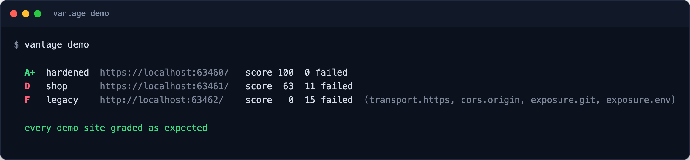

```console
$ vantage demo
  A+  hardened  https://localhost:63460/   score 100  0 failed
  D   shop      https://localhost:63461/   score  63  11 failed
  F   legacy    http://localhost:63462/    score   0  15 failed  (transport.https, cors.origin, exposure.git, exposure.env)

  every demo site graded as expected
```

The same command runs in CI on every push, so a change to a check or to the scoring that moves a grade breaks the
build.

## What it checks

| Category | Checks | Worst finding |
| --- | --- | --- |
| **Transport** | served over HTTPS · plain HTTP redirects to HTTPS | high |
| **TLS** | TLS 1.3 negotiated · TLS 1.0/1.1 refused · chain trusted · certificate matches host · certificate not expiring | critical |
| **Headers** | Strict-Transport-Security · framing restricted (X-Frame-Options / `frame-ancestors`) · X-Content-Type-Options · Referrer-Policy · Permissions-Policy · Cross-Origin-Opener-Policy · no version banners | high |
| **Content Security Policy** | policy enforced · no `'unsafe-inline'` scripts (nonces and hashes respected) · no `'unsafe-eval'` · no wildcard script sources · `object-src 'none'` · `base-uri` set | medium |
| **Cookies** | Secure · HttpOnly on session-like cookies · SameSite set (and `None` only with Secure) | medium |
| **CORS** | a foreign `Origin` is not reflected, especially not with credentials | critical |
| **Exposure** | `/.git/HEAD` · `/.env` · `/.DS_Store` · `/server-status` · `/phpinfo.php` · `/backup.zip` · `/.well-known/security.txt` | critical |
| **DNS** | SPF rejects unlisted senders · DMARC enforces a policy · CAA restricts issuers | medium |

A few details that keep the results honest:

- **Exposure probes check the body, not just the status.** Plenty of sites answer `200` with their home page for every
  path; vantage only reports `.git` when the body starts with `ref: refs/`, a zip only when it carries the `PK` magic,
  and so on.
- **Broken certificates are reported, not refused.** The scan completes against an expired, self-signed or mismatched
  certificate and reports each problem as its own finding.
- **Checks that don't apply are skipped, not failed.** A page that sets no cookies, a site on plain HTTP, or a host
  that is not a public domain skips the checks that make no sense for it, and skips cost nothing.

The full reference, with why each check matters, is in the console's [Checks](#checks) view.

## The console

`vantage serve` starts the console on <http://127.0.0.1:7070>. A sidebar switches between six views; the console
follows the system light or dark theme.

### Dashboard

The posture of every site you have scanned at a glance: how many sites, the average score, how many are watched,
open critical and high findings, and regressions. Below, the grade distribution, open findings by severity, the
latest scan of each site and the failures that are most common across them.

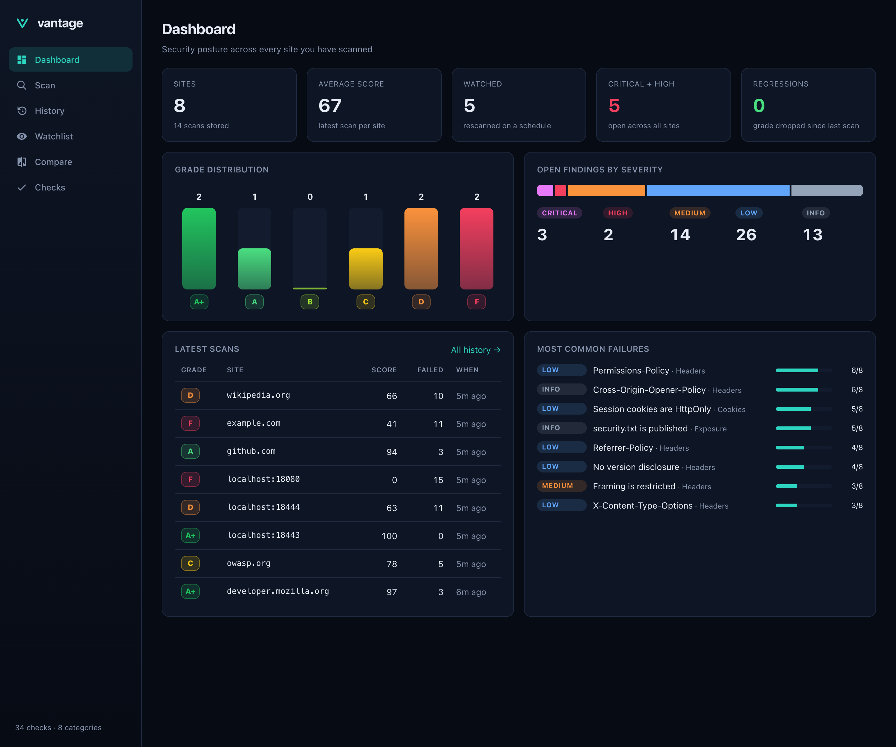

### Report

One scan in full. The grade ring and score, the status code, IP, timing and redirect chain, the count at every
severity, the TLS protocol and issuer, and a score trend when the site has been scanned before. On the left, the pass
rate of each category; on the right, every finding grouped by category with what was found and the exact fix.
Failures open by default; switch to *All* or *Passed* to see the rest.

The legacy demo site — plain HTTP, `.git` and `.env` exposed, credentials-reflecting CORS:

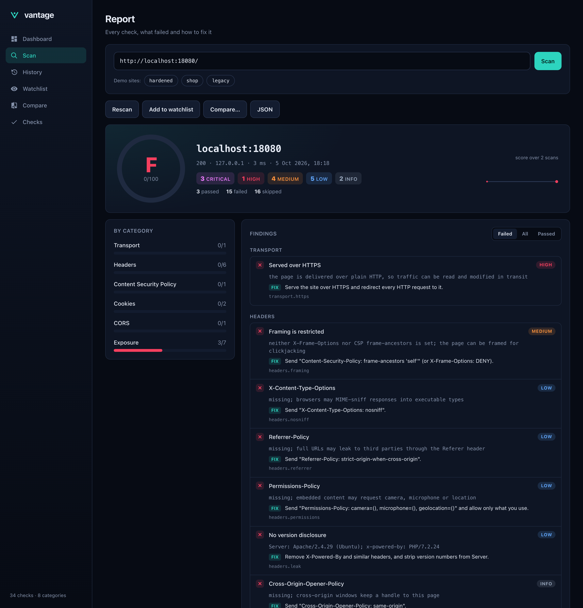

The hardened demo site — every check passing:

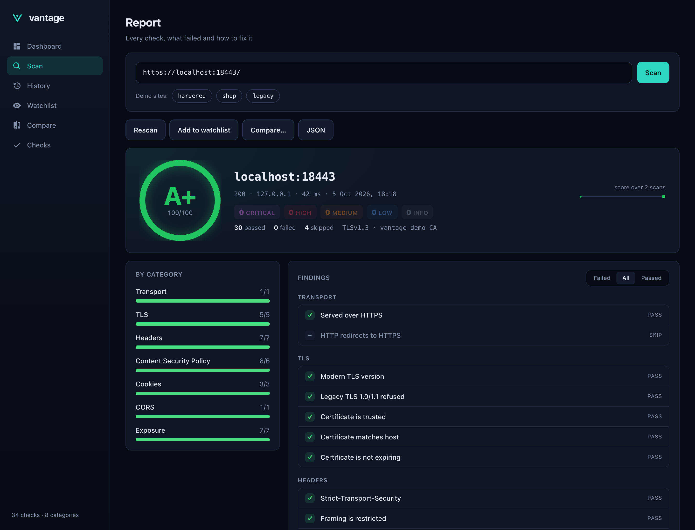

And a real site in the light theme, with the redirect chain from `wikipedia.org` to `www.wikipedia.org`:

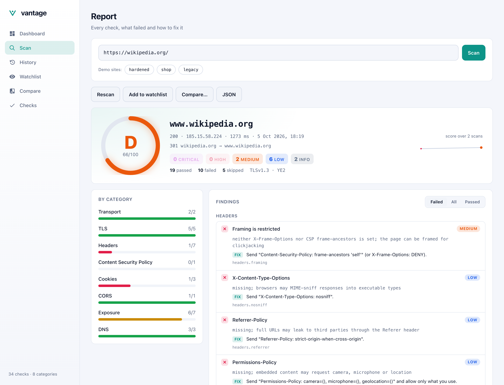

From a report you can rescan, add the site to the watchlist, compare it with another scan, or open the raw JSON.

### History

Every stored scan, newest first, with the grade, score, findings by severity, when it ran and how long it took.
Filter by site, click through to the report, or delete a scan.

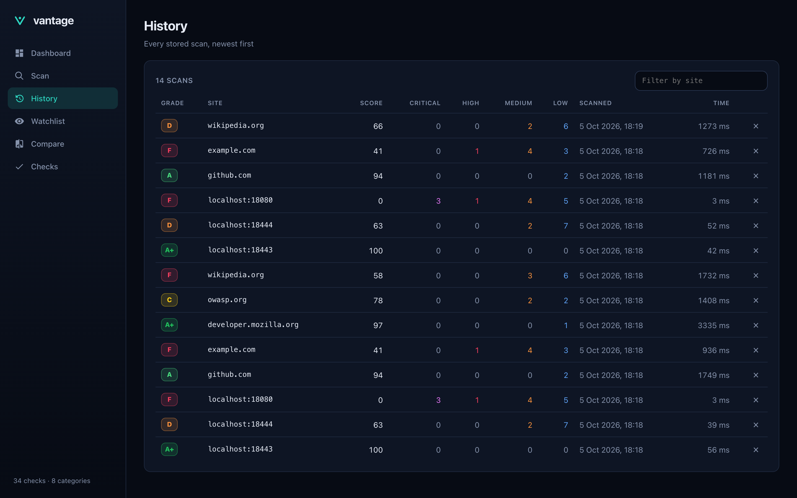

### Watchlist

Sites that are rescanned on a schedule (every 30 minutes by default). Each card shows the current grade, the score
trend over recent scans, and a flag when the grade has dropped since the previous scan — the dashboard counts those as
regressions. *Rescan all now* runs every watched site immediately.

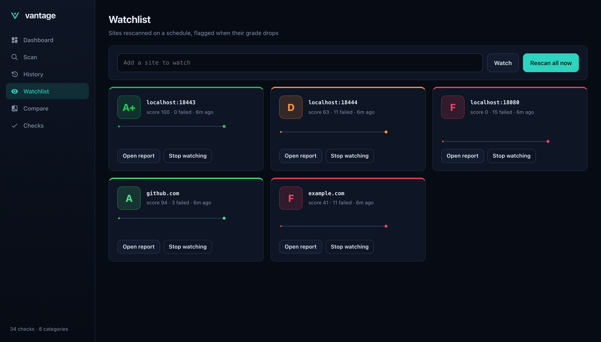

### Compare

Pick a before and an after report and vantage diffs them check by check: the score delta, how many checks were fixed
and how many regressed, and a table of every check whose status or severity changed. Useful after a deploy, or to
compare two sites with each other.

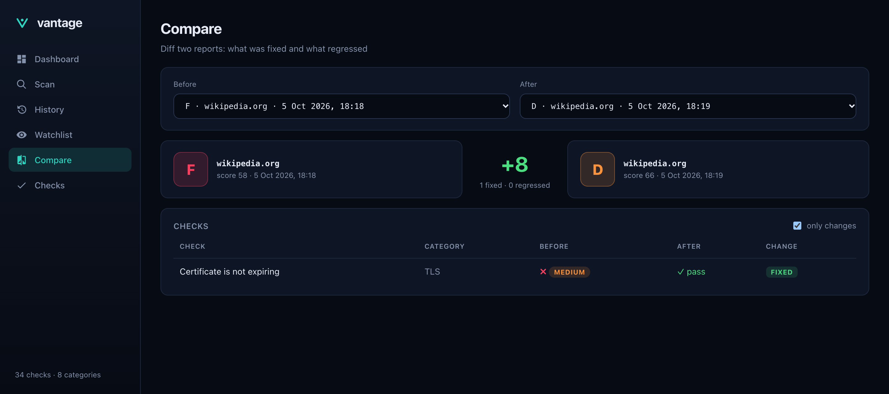

### Checks

The reference for all 34 checks, grouped by category, with the worst severity each can report and why it matters.

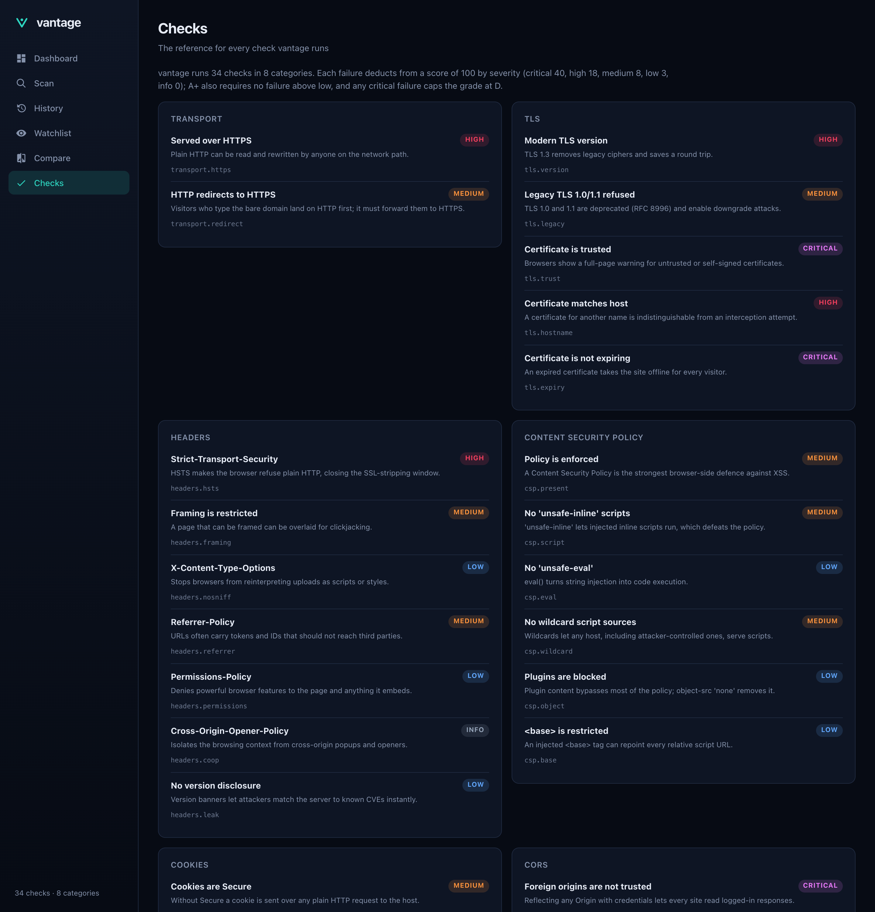

## The CLI

```console
$ vantage scan http://localhost:18080/
```

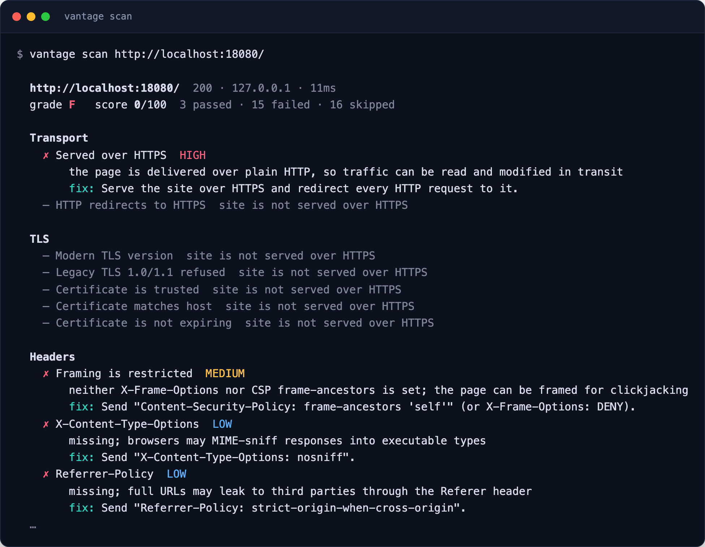

```text
vantage scan <url>... [--json] [--fail-under <grade>] [--no-dns] [--timeout <ms>] [--ca <file>]
vantage serve [--listen <host:port>] [--data <file>] [--no-demo] [--watch-every <minutes>] [--dev]
vantage demo
vantage version
```

| Command | What it does |
| --- | --- |
| `scan` | Scans one or more URLs and prints each report. `--json` prints the raw report; `--fail-under B` exits `1` when any grade is below B; `--ca` trusts an extra CA certificate (PEM), handy for internal sites; `--no-dns` skips the DNS checks. |
| `serve` | Starts the console and API. `--listen` defaults to `127.0.0.1:7070`, `--data` to `~/.vantage/data.json`. The demo sites start too unless `--no-demo`; on a fresh install they are scanned and watched so the console has data. `--dev` serves the console through Vite with hot reload. |
| `demo` | Starts the demo sites, scans each and verifies its grade. Exits `1` if any grade is unexpected. |
| `version` | Prints the version. |

`serve` also reads `VANTAGE_LISTEN` and `VANTAGE_DATA` from the environment.

## Run it

Requires Node.js 20 or newer.

```sh
git clone https://github.com/betulaydurmuss/vantage.git
cd vantage
npm install
npm run build        # build the console
npm start            # console on http://127.0.0.1:7070, with the demo sites
```

Or scan straight from the terminal:

```sh
node bin/vantage.js scan example.com
npm link             # optional: puts `vantage` on your PATH
vantage scan example.com
```

### Docker

```sh
docker build -t vantage .
docker run --rm -p 7070:7070 -v vantage-data:/data vantage
```

The image runs as an unprivileged user, listens on `0.0.0.0:7070` and keeps its data in the `/data` volume. One-off
scans work too:

```sh
docker run --rm vantage scan example.com
```

## Use it in CI

`--fail-under` turns vantage into a gate: the job fails when the grade drops below the bar.

```yaml
- uses: actions/setup-node@v4
  with:
    node-version: 22
- name: Install vantage
  run: |
    git clone --depth 1 https://github.com/betulaydurmuss/vantage.git /tmp/vantage
    npm ci --prefix /tmp/vantage --omit=dev --ignore-scripts
- name: Security posture gate
  run: node /tmp/vantage/bin/vantage.js scan https://staging.example.com --fail-under B
```

`--json` gives you the whole report for anything else — archive it as an artifact, post the grade to a pull request,
or feed the findings into another tool:

```sh
vantage scan example.com --json | jq '{grade, score, failed: [.findings[] | select(.status=="fail") | .id]}'
```

## How grading works

Every check passes, fails or is skipped. Each failure deducts from 100 by severity:

| Severity | Penalty | Examples |
| --- | --- | --- |
| critical | 40 | exposed `.git` or `.env`, CORS reflecting any origin with credentials, expired certificate |
| high | 18 | plain HTTP, untrusted or mismatched certificate, missing HSTS |
| medium | 8 | no CSP, `'unsafe-inline'` scripts, clickjacking, insecure cookies |
| low | 3 | missing nosniff or Referrer-Policy, version banners, weak DMARC |
| info | 0 | no TLS 1.3, no COOP, no `security.txt`, no CAA |

| Grade | Score | Also requires |
| --- | --- | --- |
| **A+** | 95 – 100 | no failure above low |
| **A** | 90 – 94 | |
| **B** | 80 – 89 | |
| **C** | 70 – 79 | |
| **D** | 60 – 69 | |
| **F** | below 60 | |

A single critical failure caps the grade at **D** whatever the score: a site with an exposed `.env` is not a B.

## Architecture

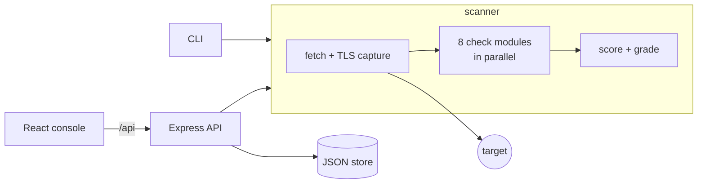

One package, three faces: the scanner in `server/scan/` is a plain library, the CLI and the Express API both call it,
and the React console talks to the API. The [architecture notes](docs/architecture.md) cover the scan pipeline, the
finding format, the API routes, persistence, the demo PKI and the console in detail.

```text
bin/vantage.js         CLI: scan, serve, demo, version
server/
  scan/                the scanner — one module per category, plus fetch, findings and the catalog
  app.js               Express API and console hosting
  store.js             history and watchlist, persisted atomically to JSON
  demo.js              the three demo sites and their in-memory CA
src/                   React console — views, components, styles
test/                  node:test suites — checks, grading, demo grades, API
docs/                  architecture notes, wordmarks, screenshots
```

Runtime dependencies are deliberately few: Express for the API, and `@peculiar/x509` to mint the demo certificates.
Everything the scanner does — HTTP, TLS, DNS — is Node's standard library.

## Development

```sh
npm install
npm run dev          # API + console with hot reload on http://127.0.0.1:7070
npm test             # 29 tests: checks, grading, demo grades, API
npm run lint
npm run build
```

The tests spin up throwaway local servers for each scenario — weak headers, nonce-based CSP, soft 404s, real leaks,
reflected CORS, redirects — and scan them, so they need no network access. CI runs lint, the test suite on Node 20,
22 and 24, the demo proof, the console build, a Docker build and CodeQL.

## Scope and responsible use

vantage makes the same requests a browser or a curious visitor would: it loads the page, opens one extra TLS
handshake, sends one request with a foreign `Origin`, requests seven well-known paths and does three DNS lookups. It
does not fuzz, brute-force or exploit anything. Even so, **scan sites you own or have permission to test.**

The console scans whatever URL it is given, which includes addresses on your local network. That is why `serve`
listens on `127.0.0.1` by default; if you bind it to another interface, keep it behind authentication and off
untrusted networks.

## License

[MIT](LICENSE)
