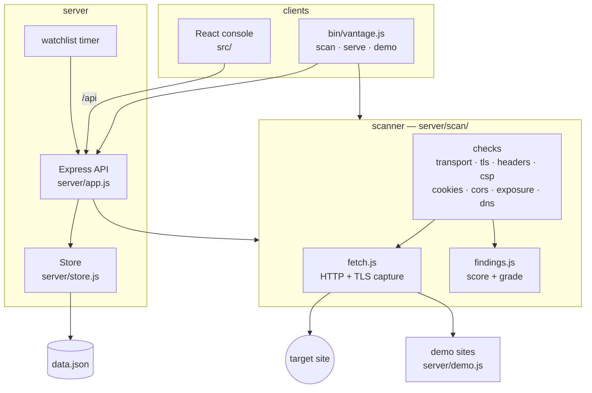
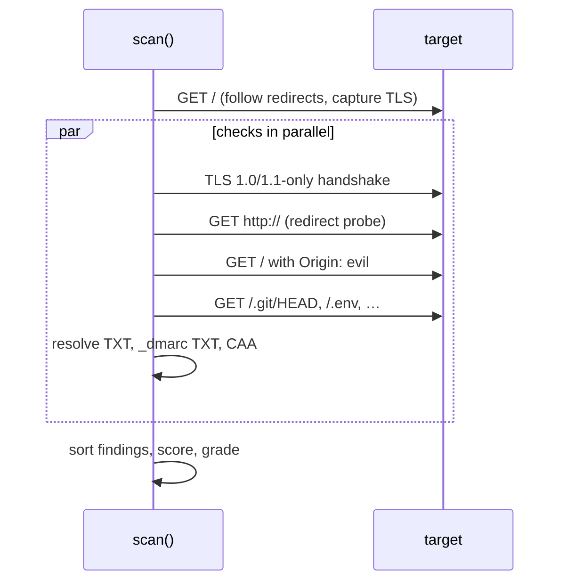

# Architecture

vantage is one Node.js package with three faces: a scanning library, a CLI and a web console. All three share the
same scanner, so a grade in the terminal is the grade in the console.



## The scan

A scan is one function call, `scan(url, options)` in `server/scan/index.js`:

1. **Normalize** the input: a bare host becomes `https://host/`; other schemes are rejected.
2. **Fetch** the page with `fetchFollow`, following up to five redirects and recording each hop. The request is made
   with Node's `https` module rather than `fetch` because the checks need the TLS socket: the negotiated protocol, the
   cipher, the peer certificate chain and whether it verified.
3. **Run every check in parallel.** Each check is a plain function that receives the shared target and returns a list
   of findings. Checks that need more traffic make it themselves — the legacy-TLS handshake, the plain-HTTP redirect
   probe, the CORS probe with a foreign `Origin`, the exposure probes and the DNS lookups.
4. **Sort and grade.** Findings are ordered by category, failures first, worst severity first, then scored.



### Certificates are verified, not enforced

The fetch sets `rejectUnauthorized: false` so that a site with a broken certificate can still be scanned and
reported on. Node still computes the verdict, and `tls.trust` reads it from `socket.authorized` and
`socket.authorizationError`. The hostname is checked separately with `tls.checkServerIdentity`, so a wrong name and an
untrusted chain are reported as two findings.

### Exposure probes validate the body

Many sites answer `200` with their home page for every path. A probe only fails when the body matches what the file
actually looks like: `ref: refs/` for `.git/HEAD`, `KEY=value` lines in a non-HTML `.env`, the `Bud1` magic in
`.DS_Store`, the `PK\x03\x04` magic in a zip. The test suite runs these probes against a soft-404 site to keep it that
way.

## Findings and grades

Every check returns findings of one shape:

```json
{
  "id": "headers.hsts",
  "category": "Headers",
  "title": "Strict-Transport-Security",
  "status": "fail",
  "severity": "high",
  "detail": "missing; browsers will still try plain HTTP first, which can be intercepted",
  "fix": "Send \"Strict-Transport-Security: max-age=31536000; includeSubDomains\"."
}
```

`status` is `pass`, `fail` or `skip`. A skip means the check does not apply (no cookies, not HTTPS, not a public
domain) and costs nothing. Each failure deducts from 100:

| severity | penalty |
| -------- | ------- |
| critical | 40      |
| high     | 18      |
| medium   | 8       |
| low      | 3       |
| info     | 0       |

| grade | score | extra rule                       |
| ----- | ----- | -------------------------------- |
| A+    | ≥ 95  | no failure above low             |
| A     | ≥ 90  |                                  |
| B     | ≥ 80  |                                  |
| C     | ≥ 70  |                                  |
| D     | ≥ 60  | any critical failure caps at D   |
| F     | < 60  |                                  |

## The server

`server/app.js` builds an Express app around a `Store`:

| route                    | purpose                                            |
| ------------------------ | -------------------------------------------------- |
| `GET  /api/meta`         | categories, grades, the check catalog, demo sites  |
| `POST /api/scan`         | scan a URL and store the report                    |
| `GET  /api/reports`      | report summaries, optionally `?target=`            |
| `GET  /api/reports/:id`  | one full report with its score trend               |
| `DELETE /api/reports/:id`| delete a report                                    |
| `GET  /api/stats`        | dashboard numbers from the latest scan per site    |
| `GET  /api/watch`        | watchlist with latest and previous grade           |
| `POST /api/watch`        | watch a URL                                        |
| `DELETE /api/watch/:id`  | stop watching                                      |
| `POST /api/watch/run`    | rescan every watched site now                      |

At most four scans run at once; extra requests get `429`. Request bodies are capped at 16 KB.

In development (`--dev`) Vite runs as Express middleware, so one process serves the API and the hot-reloading
console. In production the built console in `dist/` is served statically with an SPA fallback.

### Persistence

The `Store` keeps reports (newest first, capped at 500) and the watchlist in memory and writes them to one JSON file.
Writes are serialized through a promise chain and made atomic by writing a temp file and renaming it over the old one,
so a crash mid-write never leaves a truncated file.

### The watchlist

`vantage serve` rescans every watched site on a timer (`--watch-every`, 30 minutes by default). The dashboard flags a
regression whenever a site's latest grade is lower than the one before it.

## The demo sites

`server/demo.js` starts three local sites so everything works with nothing to configure:

| site       | serves                                                                                  | grade |
| ---------- | --------------------------------------------------------------------------------------- | ----- |
| `hardened` | HTTPS, TLS 1.3, every header, strict CSP, `__Host-` cookie, `security.txt`              | A+    |
| `shop`     | HTTPS, short HSTS, `'unsafe-inline'` CSP, leaky headers, cookies without SameSite       | D     |
| `legacy`   | plain HTTP, exposed `.git` and `.env`, `phpinfo()`, reflected CORS with credentials      | F     |

The HTTPS sites use a certificate authority generated in memory at start-up (ECDSA P-256 via WebCrypto). The scanner is
given that CA as an extra trust root, so the hardened site earns a clean TLS result without trusting anything
globally. `vantage demo` and the test suite assert each site's grade, which makes the demo a regression test for the
scoring.

## The console

The React app in `src/` is a single page with hash routing and no state library: each view fetches what it needs from
the API. Views are keyed by route, so navigating always starts a view with fresh state.

| view      | file                    |
| --------- | ----------------------- |
| Dashboard | `src/views/Dashboard.jsx` |
| Scan / Report | `src/views/Scan.jsx`, `src/components/Report.jsx` |
| History   | `src/views/History.jsx`   |
| Watchlist | `src/views/Watchlist.jsx` |
| Compare   | `src/views/Compare.jsx`   |
| Checks    | `src/views/Checks.jsx`    |

Colours, spacing and both themes live in CSS custom properties in `src/styles.css`; the console follows the system
light or dark preference.
